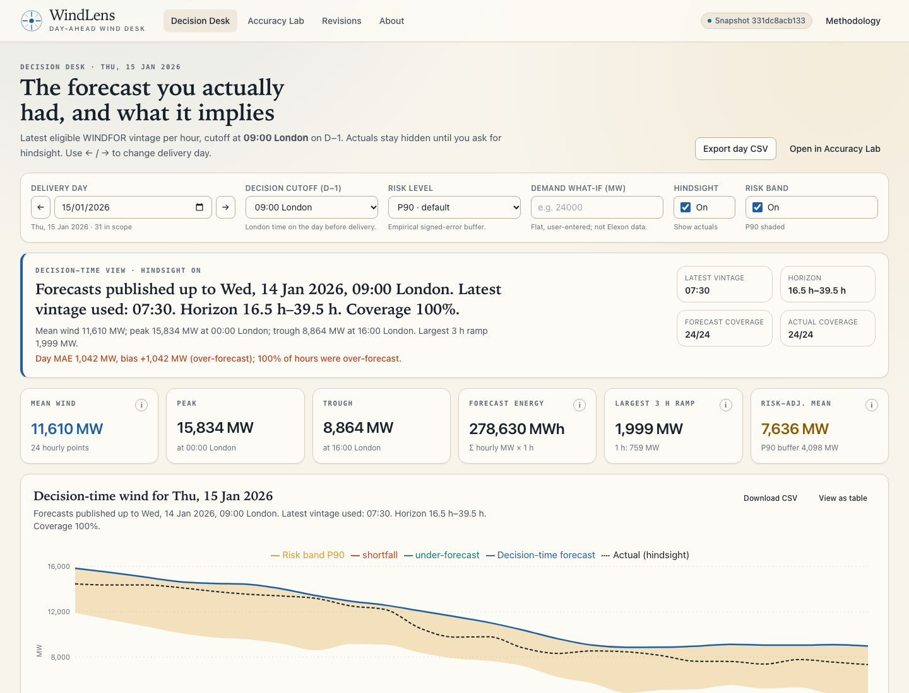
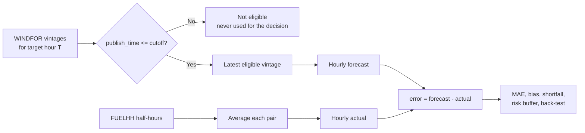
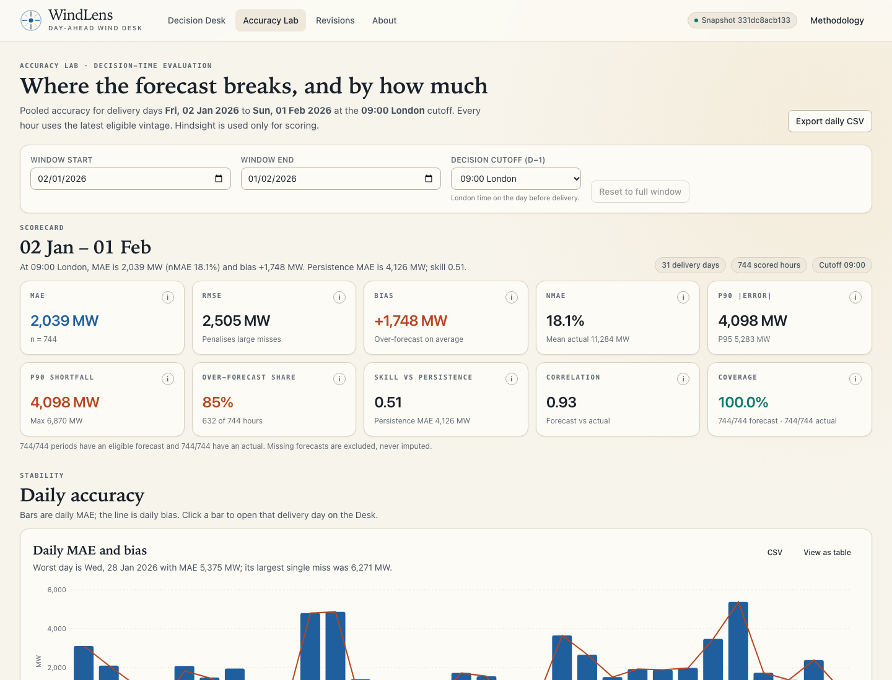
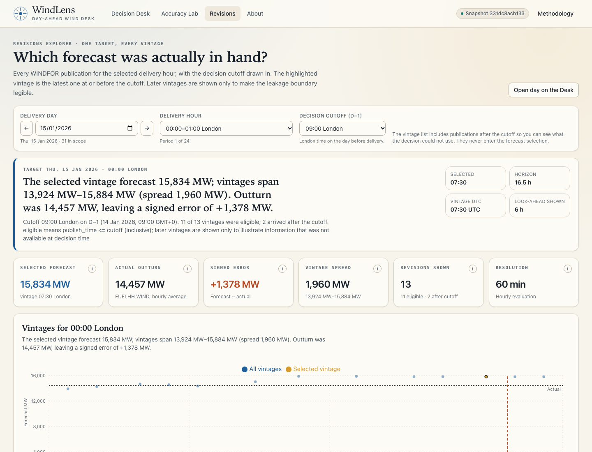

# WindLens

**Day-ahead wind decision support built on the forecast a buyer actually had.**

[](https://github.com/Sneh30/rjbjru/actions/workflows/ci.yml)
[](LICENSE)
[](docs/DATA_SOURCES.md)
[](#architecture)

WindLens answers two questions for a day-ahead wind buyer. First, what wind
forecast was genuinely available at the decision cutoff, and what does it imply
for the next delivery day? Second, how wrong has that forecast been, in which
direction, and how large a shortfall buffer does the record justify? It uses only
the two permitted Elexon datasets — `FUELHH` filtered to wind outturn and
`WINDFOR` forecast vintages — frozen into a committed, fingerprinted snapshot and
served by a FastAPI API and a React interface.

> **Live demo:** [windlens-vhdegk.vercel.app](https://windlens-vhdegk.vercel.app) —
> public, no login wall.
> **Source:** [github.com/Sneh30/rjbjru](https://github.com/Sneh30/rjbjru).
>
> The application and data snapshot are verified; the production commands and
> outputs are in
> [`docs/AUDIT.md`](docs/AUDIT.md#14-public-repository-and-production-deployment).



## What it does

- **Decision Desk.** Pick a London delivery day and a cutoff. WindLens selects
  the latest forecast vintage published at or before that cutoff, shows the
  hourly wind curve, the selected publication time and the horizon for every
  hour, and optionally reveals actuals and forecast error. It also applies an
  empirical shortfall buffer and a user-entered demand scenario.
- **Accuracy Lab.** Scores the decision-time forecast over the configured
  window: MAE, RMSE, bias, nMAE, shortfall percentiles, persistence skill,
  horizon growth, hour-of-day and wind-level breakdowns, worst days and hours,
  cutoff sensitivity, and a leakage-safe walk-forward risk calibration.
- **Revisions explorer.** Shows every WINDFOR vintage for one target hour,
  marks the selected vintage, and draws the cutoff so the no-look-ahead boundary
  is visible rather than asserted.

The core idea is **decision-time vintage selection**, not "latest forecast
available now":



The cutoff is **09:00 Europe/London on D−1** by default and the boundary is
inclusive. A publication at exactly 09:00 is eligible; one at 09:01 is not. The
same rule drives the charts, the API, the CSV export and the analysis, so the
number on screen and the number in `docs/INSIGHTS.md` cannot silently diverge.

## Screenshots

| Accuracy Lab | Revisions explorer |
|---|---|
|  |  |

The screenshots were captured from the Docker Compose stack against the
committed snapshot, using the reproducible capture script described in
[`docs/AUDIT.md`](docs/AUDIT.md).

## Quick start

### Docker (reference runtime)

```bash
docker compose up --build
# web: http://localhost:8080
# api: http://localhost:8000
```

The first build takes a few minutes because it installs Python and Node
dependencies. The API container runs as uid 10001 with a read-only root
filesystem and a `tmpfs` `/tmp`; nginx serves the SPA and proxies `/api` to the
API. To verify the stack end to end:

```bash
bash scripts/smoke_docker.sh
```

Stop it with `docker compose down -v`.

### Local development

```bash
make setup    # backend virtualenv + frontend npm ci
make dev      # uvicorn on :8000, Vite on :5173
```

Open `http://localhost:5173`. Vite proxies `/api` to the backend. The OpenAPI
UI is at `http://localhost:8000/api/docs`.

### Regenerate the data and analysis

```bash
make ingest            # live Elexon pull, normalise, validate, write data/processed/
make verify-snapshot   # re-hash the processed files against the manifest
make insights          # regenerate docs/INSIGHTS.md and docs/insights.json
```

`make build-snapshot` rebuilds from the local raw cache without network access.
The committed snapshot is the source of every product number; the small files in
`backend/tests/fixtures/` are test inputs only.

## Directory guide

```text
analysis/                 Deterministic insight generator (same domain code as the API)
api/index.py              Vercel ASGI entrypoint
backend/app/
  api/                    FastAPI routes, Pydantic schemas, RFC 7807 errors, middleware
  data/                   Snapshot loader, hash validation, typed repository
  domain/                 Pure selection, time, join, metrics, breakdowns, risk, baseline
  ingestion/              Elexon client, normalisation, validation, CLI, snapshot builder
  services/               Window validation, caches, payload composition, rounding
backend/tests/            Unit, contract, leakage, ingestion and insight tests
data/processed/           Committed gzipped snapshot, manifest, quality report
data/raw/                 Local ingestion cache (gitignored)
docs/
  DATA_SOURCES.md         Verified Elexon endpoint contracts and live-pull provenance
  METHODOLOGY.md          Scope, formulas, worked example, risk definitions, caveats
  DECISIONS.md            ADRs 001–016
  ARCHITECTURE.md         Context, container, sequence, selection and layering diagrams
  INSIGHTS.md             Generated findings (do not edit by hand)
  insights.json           Exact API payloads behind the findings
  AUDIT.md                Verification log with pasted command output
  VIDEO_SCRIPT.md         Timed recording script and pre-record checklist
  FORM_ANSWERS.md         Draft submission answers; reconcile against the real form
frontend/
  src/                    React routes, components, charts, hooks, API client, styles
  e2e/                    Playwright smoke and axe suites
  nginx.conf              SPA serving, /api proxy, security headers, cache rules
scripts/                  Type generation, smoke test, deploy check, anonymity, hygiene
.github/workflows/ci.yml  Backend, frontend, contract, Docker and anonymity jobs
docker-compose.yml        API + nginx web tier
vercel.json               SPA build, Python function, rewrites and headers
HUMAN_ACTIONS.md          Ordered hand-off: push, deploy, record, form, incognito pass
```

## Methodology summary

| Item | Choice |
|---|---|
| Scope | Decisions on 2026-01-01 → 2026-01-31; deliveries 2026-01-02 → 2026-02-01 |
| Cutoff | 09:00 Europe/London on D−1, inclusive |
| Resolution | WINDFOR is hourly; each hourly actual is the mean of two FUELHH half-hours |
| Sign | `error = forecast − actual`; positive is over-forecast and shortfall risk |
| Headline metrics | MAE, RMSE, bias, nMAE, WAPE, MAPE, absolute/signed percentiles, correlation |
| Skill | Persistence baseline from the last hourly actual observable at the cutoff |
| Horizon | `(target hour − selected publish time) / 1 h`; the analysis table pools all vintages |
| Risk | Empirical signed-error quantile; `risk_adjusted = max(0, forecast − buffer)` |
| Back-test | Walk-forward, two-day outcome lag, minimum seven history days |

Full formulas, a hand-checkable worked example for 2026-01-15, the moving-parts
definition of horizon, and all caveats are in
[`docs/METHODOLOGY.md`](docs/METHODOLOGY.md). The short version: nothing is
imputed, no later vintage leaks into a decision, and no bias correction is fitted
to make the forecast look better.

## Key findings

From the committed snapshot and the default 09:00 cutoff
([`docs/INSIGHTS.md`](docs/INSIGHTS.md)):

- Across **744 hourly targets**, the selected WINDFOR forecast has MAE
  **2,038.9 MW** and nMAE **18.07%**.
- Bias is **+1,747.9 MW** and **85.0%** of hours are over-forecast, so the error
  is directional shortfall risk rather than symmetric noise.
- P90 shortfall is **4,097.9 MW**, P95 is **5,283.4 MW**, and the maximum is
  **6,870.0 MW**.
- Persistence scores **4,125.9 MW** MAE; the forecast's skill is **0.51**, a
  **50.58%** MAE reduction.
- Decision horizons run from **16.5 h** to **39.5 h** (mean **28.0 h**); the
  latest vintage beats the earliest eligible vintage by **18.79%** of MAE
  (**2,422.1 MW** vs **2,038.9 MW**).
- At the 90th-percentile risk level the in-sample buffer is **4,097.9 MW**;
  walk-forward coverage is **86.0%** over **23** evaluated days, with a mean
  buffer of **4,051.8 MW** and **22.0%** of days containing a breach.

Every one of the **744** targets has a selected forecast and an actual. There are
no missing periods and no interpolation. The 12:00 cutoff would lower MAE to
**1,901.0 MW** (**6.76%** below the default), but it shortens mean horizon to
**24.1 h**; the product reports that trade-off instead of calling it a free win.

## API overview

Base path `/api/v1`. Interactive docs: `/api/docs`; machine-readable schema:
`/api/openapi.json`. Live docs: <https://windlens-vhdegk.vercel.app/api/docs>.
The Swagger UI is self-hosted, so it renders under the strict CSP without any
third-party request.

| Endpoint | Purpose |
|---|---|
| `GET /health` | Liveness, version and snapshot fingerprint |
| `GET /meta` | Scope, available dates, cutoffs, coverage and provenance |
| `GET /decision-view` | Selected forecast for a delivery day; actuals opt-in |
| `GET /revisions` | Every vintage for one target, with eligibility flags |
| `GET /accuracy/summary` | Pooled scorecard and persistence skill |
| `GET /accuracy/daily` | Daily MAE, bias and worst period |
| `GET /accuracy/by-horizon` | Error by lead-time bucket |
| `GET /accuracy/by-hour` | Error by London hour of day |
| `GET /accuracy/by-level` | Error by actual or forecast wind quintile |
| `GET /accuracy/distribution` | Signed-error histogram and scatter sample |
| `GET /accuracy/worst` | Worst days or individual hours |
| `GET /accuracy/cutoff-sensitivity` | Full cutoff grid |
| `GET /risk/buffer` | In-sample empirical buffers overall and by hour |
| `GET /risk/backtest` | Leakage-safe walk-forward coverage |
| `GET /export/decision-view.csv` | CSV of the decision table |
| `GET /export/accuracy.csv` | CSV of the accuracy payload |

```bash
curl -s "http://localhost:8000/api/v1/health" | jq
curl -s "http://localhost:8000/api/v1/decision-view?delivery_date=2026-01-15&cutoff=09%3A00" \
  | jq '.points[0], .summary'
curl -s "http://localhost:8000/api/v1/accuracy/summary" \
  | jq '.metrics | {n, mae_mw, bias_mw, nmae_pct}'
curl -s "http://localhost:8000/api/v1/risk/backtest?level=0.9" \
  | jq '{evaluated_days, coverage, mean_buffer_mw, days_with_breach_share}'
curl -sD - -o /tmp/windlens-decision.csv \
  "http://localhost:8000/api/v1/export/decision-view.csv?delivery_date=2026-01-15" \
  | head -20
```

Decision responses hide actuals and hindsight fields unless
`include_actuals=true` is supplied. Errors use `application/problem+json` with a
stable type, title, status, detail, instance and request id. Data responses carry
an ETag derived from the snapshot fingerprint and query, and honour
`If-None-Match` with a 304.

## Testing and quality

```bash
make lint typecheck test     # Ruff, ESLint, mypy strict, TypeScript, pytest, Vitest
make build                   # production frontend build
make types                   # regenerate OpenAPI TypeScript types
cd frontend && npx playwright test   # browser smoke + axe
bash scripts/smoke_docker.sh         # containerised end-to-end checks
bash scripts/check_anonymity.sh
bash scripts/check_no_placeholders.sh
bash scripts/check_numbers_consistency.sh
python3 scripts/check_video_timing.py
```

Current local results are recorded with full output in
[`docs/AUDIT.md`](docs/AUDIT.md): 198 backend tests at 92.87% coverage (85% gate),
79 frontend tests at 95.08% statement/line coverage, TypeScript strict and ESLint
clean, 11 Playwright checks including five axe scans with zero serious or
critical violations, and a passing container smoke test. The same 11 Playwright
checks pass against the production URL. The GitHub Actions workflow runs the
same lint, type, test, contract, Docker-build and anonymity jobs on push.

The frontend tests use trimmed chart fixtures (30 of 744 scatter points) while
the API continues to report the full `scatter_total=744`. This keeps the suite
fast without pretending the fixture is the dataset.

## Deployment

Production: **<https://windlens-vhdegk.vercel.app>**, served by the existing
`windlens-vhdegk` Vercel project. The project uses the **Other** framework preset;
`vercel.json` supplies the SPA build, the Python function, the `/api/*` rewrite
and the security headers. The Python function bundles `backend/app/**` (including
the self-hosted Swagger UI) and `data/processed/**`; no database or external cache
is required.

The function is built on Python 3.12 through `build.env.UV_PYTHON` in
`vercel.json`, because the pinned `pydantic-core` has no Python 3.14 wheel. The
deployed function is **70.9 MB**, inside Vercel's 250 MB limit. Observed TTFB for
`/api/v1/health` was **0.50–0.71 s** on the first requests after deployment and
**0.28–0.36 s** once warm; that is an observation, not a controlled cold-start
benchmark.

```bash
bash scripts/verify_deploy.sh "https://windlens-vhdegk.vercel.app"
```

The script checks the SPA shell, health, metadata, a decision view, the accuracy
summary, the self-hosted docs assets, the CSV export, `robots.txt` and
`favicon.ico`, and fails on a protection wall or a missing JSON field. The
public account URL and deployment host are accepted by the recorded H2 decision.

Heroku is a fallback, not the primary path: the API image can run there, but
serving the SPA from the same process requires copying `frontend/dist` into the
image and mounting it with FastAPI `StaticFiles`. That variant is documented in
`docs/ENGINEERING_REFERENCE.md` §12.3 and is not configured in `vercel.json`.
ADR-007 remains the fallback if the hosted function grows beyond the size limit:
precompute the cutoff-grid selections or move the request path to NumPy-only
arrays. The local Docker stack is the reference runtime.

## Assumptions and limitations

- **Direct comparison, no rescaling.** WINDFOR and FUELHH wind are compared as
  published. The +1,747.9 MW bias is retained as measured risk. Timestamp shifts
  did not explain the level difference; a portfolio-coverage mismatch is possible
  and is not resolved by the two permitted datasets.
- **Hourly evaluation.** WINDFOR is hourly in the live feed, despite the brief's
  half-hourly example. Hourly actuals are the mean of two half-hours; intra-hour
  variability is not scored.
- **One month, one season.** The window is 31 January delivery days. The
  walk-forward back-test has 23 evaluated days, so tail coverage is indicative,
  not precise.
- **No capacity normalisation.** Installed wind capacity is outside the permitted
  data, so nMAE uses mean actual output. It is not directly comparable to a
  capacity-normalised metric from another system.
- **Snapshot, not live feed.** The app serves the committed snapshot and does not
  call Elexon at request time. `make ingest` refreshes it; the fingerprint and
  manifest make the version explicit.
- **No missing-data heroics.** Missing actuals are excluded and counted; missing
  forecasts are omitted and counted. Nothing is imputed.
- **Not financial advice.** WindLens is an analytical decision aid built for a
  take-home evaluation, not a trading or scheduling system.

## AI assistance disclosure

**AI assistance disclosure.** This project was built with AI assistance:
**DeepSeek V4.1 Flash Free**, running in the **OpenCode** agent harness, was used
for planning, scaffolding, writing and reviewing code, tests and documentation.
The human author is responsible for reviewing the work, validating the data and
results, and handling the deployment, video and submission steps. The author
confirms that this disclosure is accurate before publishing the repository.

The long form, including what the AI did not do and what the human must check, is
in [`docs/AI_DISCLOSURE.md`](docs/AI_DISCLOSURE.md). The human author should edit
the confirmation sentence if the tool list changes.

## License

MIT. See [`LICENSE`](LICENSE). The licence holder is "The WindLens contributors",
not a personal name.
