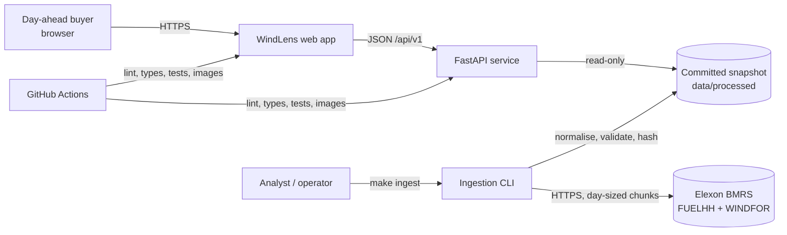
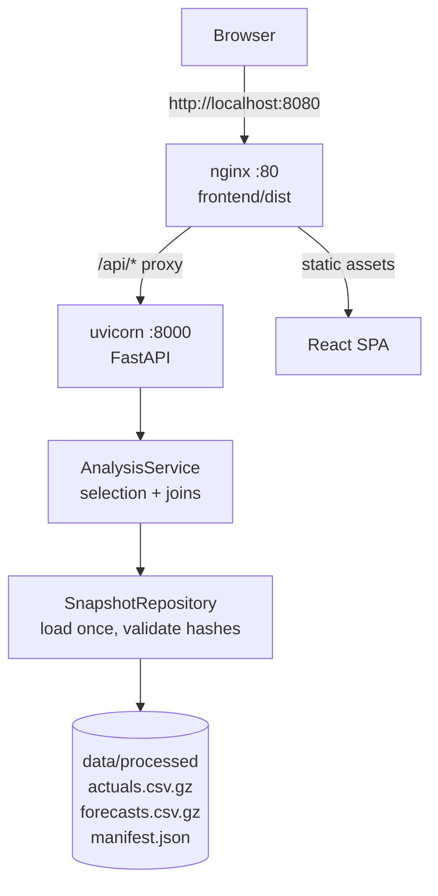
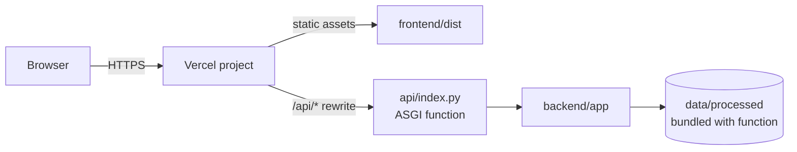
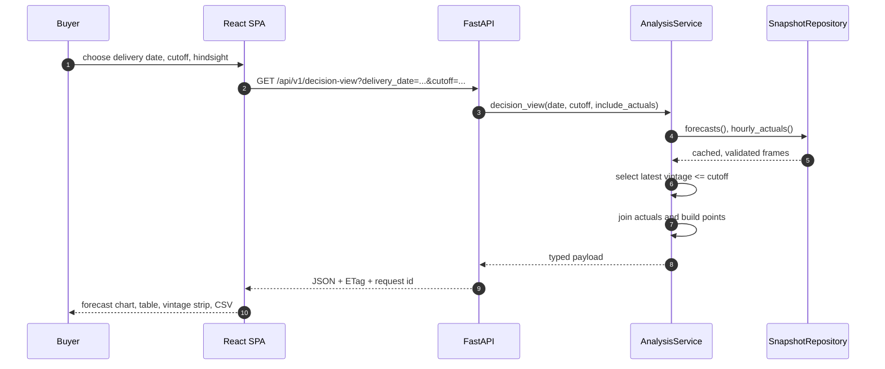
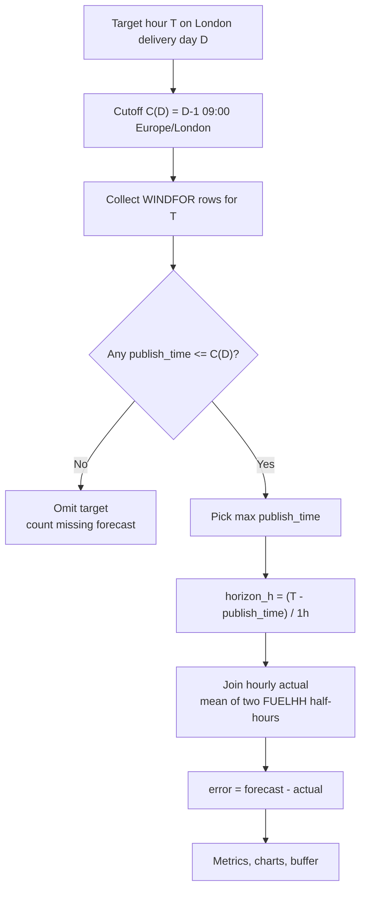
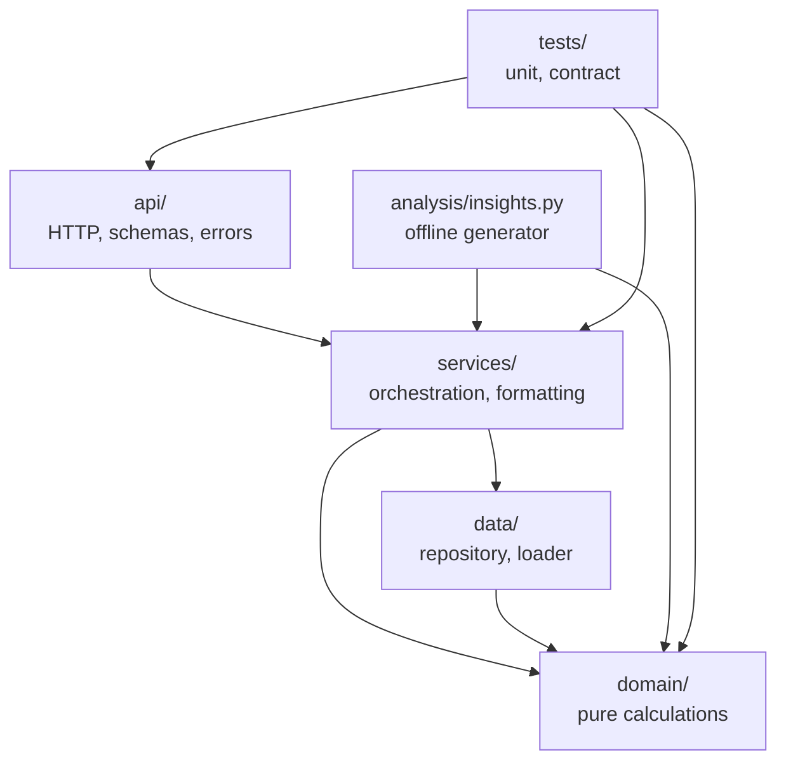

# Architecture

WindLens is a decision-time analytics application with a deliberately small
runtime surface: a React single-page app, a FastAPI JSON API, and an immutable
Elexon snapshot. Ingestion is an offline command. Nothing in the serving path
calls Elexon.

## 1. System context



The two permitted source datasets are the only external dependencies. The
application is useful without network access once the snapshot is present.

## 2. Container view

### 2.1 Docker Compose (local and reviewable deployment)



Compose runs the API as uid 10001 with a read-only root filesystem and a tmpfs
`/tmp`. The web tier is nginx, which serves the built SPA and proxies `/api` to
the API service on the internal network. Health checks gate the web tier on the
API being healthy.

### 2.2 Vercel (primary hosted deployment)



`vercel.json` builds the SPA, rewrites `/api/*` to the Python function, and
rewrites other paths to `index.html` for client-side routing. The function
inserts `backend/` on `sys.path` and exposes `app.main:app`. The function bundle
includes `backend/app/**` and `data/processed/**`; no database or external cache
is required.

The Vercel deployment itself is a human action (`HUMAN_ACTIONS.md` H4/H5)
because the default project URL can expose the authenticated account. The
repository is deployment-ready; the public URL is not fabricated in this build.

## 3. Request sequence: Decision Desk



The `SnapshotRepository` verifies the processed-file SHA-256 hashes against the
manifest during construction. The `AnalysisService` caches selected and joined
frames per cutoff, so repeated requests for a day or window reuse the join rather
than re-reading files. The API adds an ETag derived from the snapshot fingerprint
and the normalised query, and returns 304 for a matching `If-None-Match`.

## 4. Selection logic



Invariants enforced in code and tests:

- No selected row has `publish_time > cutoff_utc`.
- The selected publication is the maximum eligible publication for the target.
- The cutoff boundary is inclusive.
- A target with no eligible publication is absent, not back-filled.
- An hourly actual with either half-hour missing is null, not interpolated.
- All timestamps entering the domain are timezone-aware UTC; London conversion
  happens only for market-day boundaries and hour labels.

## 5. Layering



| Layer | Responsibility | Must not do |
|---|---|---|
| `domain/` | Selection, time handling, joins, metrics, breakdowns, risk, baselines | Import FastAPI, read files, log, round for display |
| `data/` | Read snapshot, validate hashes, expose typed frames | Change the domain rules |
| `services/` | Window validation, cache, compose payloads, round at the boundary | Re-implement metric formulas |
| `api/` | Query parsing, response models, RFC 7807 errors, caching headers | Contain analysis logic |
| `analysis/` | Offline insight generation from the same code | Be the only place a number is defined |
| `frontend/` | Presentation, URL state, charts, tables, explanations | Compute product metrics in the browser |

The dependency direction is checked by `import-linter` in the backend
development configuration. The domain layer is pure and fully unit-tested; the
API contract tests exercise the real snapshot.

## 6. Data model

The snapshot has three core columns:

- `actuals.csv.gz`: `start_time` (UTC, half-hourly), `generation_mw`.
- `forecasts.csv.gz`: `start_time` (UTC, hourly target), `publish_time` (UTC),
  `generation_mw`.
- `manifest.json`: source URLs, raw chunk hashes, processed file hashes,
  fingerprints, row counts, policy text and the generation timestamp.

`SnapshotRepository` derives hourly actuals by pairing half-hours. It also
derives coverage and quality counters used by `/api/v1/meta` and the About page.
The fingerprint is the first 16 hex characters of
`sha256(actuals_hash + forecasts_hash + schema_version)`, so a changed snapshot
changes the fingerprint and invalidates every ETag.

## 7. API design

- Base path `/api/v1`; breaking changes would introduce `/api/v2`.
- OpenAPI at `/api/openapi.json`; Swagger UI at `/api/docs`.
- Response schemas are Pydantic models with `extra="forbid"` and explicit
  optional fields. Unknown query parameters are rejected with 422.
- Errors use `application/problem+json` with a stable `type`, `title`, `status`,
  `detail` and `instance`, plus a request id.
- `Cache-Control: public, max-age=300, stale-while-revalidate=3600` for data
  endpoints; health is `no-store`.
- `ETag` is a fingerprint-and-query hash; conditional requests return 304.
- CSV exports use the same service payloads, so the table and download cannot
  disagree.
- CORS is restricted to configured origins; methods are `GET`, `HEAD`, `OPTIONS`.
- Security headers are set by the API middleware and by nginx/Vercel at the edge.

The frontend's `src/types/openapi.d.ts` is generated from the live OpenAPI
schema with `openapi-typescript`; CI regenerates it and fails on a diff. The
hand-written `src/types/api.ts` is the UI's readable source of truth for
component props; the generated file catches schema drift at the contract layer.

## 8. Frontend

The SPA has four routes:

| Route | Purpose |
|---|---|
| `/desk` | Decision-time forecast, hindsight, vintage strip, risk buffer, demand what-if, CSV |
| `/lab` | Scorecard, daily trend, horizon, hour, level, distribution/scatter, worst days/hours, cutoff sensitivity, risk calibration, data quality |
| `/revisions` | Every vintage for one target, the selected vintage, the eligibility boundary |
| `/about` | Methodology, provenance, glossary, AI disclosure, reproduction commands |

Query parameters are the source of truth for delivery date, cutoff, lab window,
chart basis, risk level and hindsight. Changing a control writes the URL, so a
view can be bookmarked or shared. The demand what-if stays local because it is a
user-entered scenario, not a server fact.

Charts are wrapped in `ChartFrame`, which exposes a heading, a description and a
table alternative. Chart internals are `aria-hidden`; the accessible name and
the data table carry the meaning. Tables inside scroll containers are focusable
regions. The production build is checked with Playwright and axe; the browser
suite injects axe through the DevTools evaluation channel because the production
CSP correctly blocks inline script tags.

## 9. Deployment and operations

### Docker

```bash
docker compose up --build
# web: http://localhost:8080
# api: http://localhost:8000
bash scripts/smoke_docker.sh
```

The API image installs only runtime requirements, copies the app and processed
snapshot, runs as a non-root user, and has a health check. The web image builds
the SPA in a Node stage and serves it from nginx. nginx keeps security headers at
the server level so child `add_header` directives cannot silently drop them.

### Vercel

1. Import the repository; use the "Other" framework preset.
2. The build command and output directory come from `vercel.json`.
3. Disable Deployment Protection for the production deployment.
4. Run `scripts/verify_deploy.sh https://<the-actual-url>` and check the URL for
   identity leakage before publishing it.

Vercel's Python bundle is larger than a static-only app because it includes
pandas/NumPy and the snapshot. The local Docker build is the reference runtime.
If the hosted bundle or cold start becomes a problem, ADR-007's fallback is to
precompute the cutoff-grid selections or move the request path to NumPy-only
arrays. That trade-off is documented rather than hidden.

### Heroku fallback

The Vercel path is primary. A container-based Heroku deployment can run the same
API image; serving the SPA from the same process requires copying `frontend/dist`
into the image and mounting it with FastAPI `StaticFiles`. This is documented in
`ENGINEERING_REFERENCE.md` §12.3 and is not the primary configuration.

## 10. Failure modes

| Failure | Detection | Response |
|---|---|---|
| Snapshot missing or corrupt | Startup hash validation | App starts with a typed startup error; health reports unavailable |
| Date outside configured scope | Query validation | 404 problem+json with the valid range |
| No eligible vintage | Selection | Target omitted; coverage counts it; UI shows a gap |
| Missing actual | Join | Actual null; target excluded from metrics |
| Empty metric set | Domain | `n=0`, null metrics; UI empty state |
| Bad query parameter | Pydantic | 422 problem+json with field errors |
| API timeout | Frontend fetch wrapper | 20 s timeout, retry once, actionable error state |
| Stale generated types | CI `make types` diff | Build fails |
| Stale insights | Contract test against live API | Test fails |

## 11. Observability and security

- JSON request logs include timestamp, level, request id, method, path, status and
  duration. The request id is returned as `X-Request-ID`.
- Health reports status, version, fingerprint and row counts.
- The API is read-only; there is no auth surface to misconfigure, and no user data
  is stored.
- Response headers include `X-Content-Type-Options`, `X-Frame-Options`,
  `Referrer-Policy`, `Permissions-Policy` and `Cross-Origin-Resource-Policy`.
- The nginx/Vercel CSP restricts scripts to same-origin, disallows framing and
  object embedding, and keeps `base-uri` and `form-action` locked down.
- No secrets are required at runtime. `.env` is gitignored.

## 12. Performance

The snapshot is small: 1,536 actual half-hours and 19,856 forecast rows. The
repository loads it once per process, and selection is a vectorised groupby over
a few thousand rows. The frontend uses TanStack Query with a five-minute stale
time and per-parameter keys; the API caches by cutoff in the service layer and
emits an ETag. The expensive work is ingestion, not serving.
